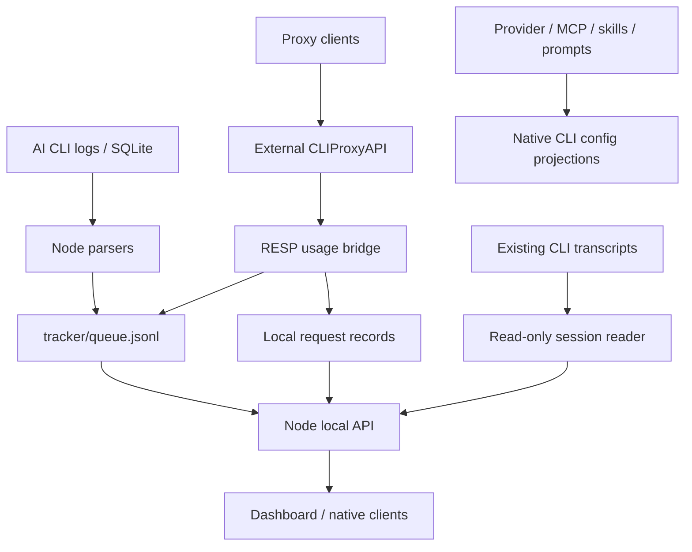

<div align="center">

# AiTool

**English** · [简体中文](./README.zh-CN.md)

### One toolbox for your AI coding workflow — a multi-provider AI gateway plus a token usage dashboard, in one local app.

AiTool merges three open-source projects into a single local-first product:

- **AI Proxy** (from [EasyCLIProxyAPI](https://github.com/router-for-me/EasyCLIProxyAPI) / [CLIProxyAPI](https://github.com/router-for-me/CLIProxyAPI), MIT) — run a local gateway that exposes your provider accounts through OpenAI / Anthropic / Gemini compatible endpoints, with per-request usage records.
- **Token usage analytics** (from [TokenTracker](https://github.com/xiufengsun/TokenTracker), MIT) — the local-first dashboard that tracks token usage and cost across 45 AI coding tools.
- **Provider config management** (from [cc-switch](https://github.com/farion1231/cc-switch), MIT) — manage provider presets and native config/launch profiles for ten CLI tools, plus shared MCP/skills, prompts, profiles, diagnostics, distribution and quota reads; nine tools also have read-only session history — without hand-editing JSON / TOML.

The UI is TokenTracker's design language throughout — one dashboard for both worlds: proxied requests flow into the same trends, model breakdown, and cost views as your native CLI tools.

</div>

---

This repository is the personal fork `rijing-joker/AITool`, maintained on `dev` without version bumps, npm publication or desktop releases. Legacy names and paths remain for compatibility.

[Architecture and capability matrix](./docs/architecture.md) · [Documentation index](./docs/README.md) · [Run guide](./docs/running.md) · [Privacy](./docs/PRIVACY.md)

## How the merge works



The core stays an external, independently updatable process (currently **v8.0.37** in `core-version.txt`, same pattern as EasyCLIProxyAPI). A changed pin does not replace an already installed core automatically. The bridge folds every successful proxied request into TokenTracker's half-hour buckets, so **proxy usage shows up in the standard dashboard automatically** — trends, model breakdown, cost, heatmap — alongside Claude Code, Codex, Gemini and other native tools.

## Quick start

Requirements: **Node.js 22.19+** for current dependencies; **Node 24** recommended for development/tests. Package metadata still declares ≥20, which does not cover the current dependency requirements. The proxy core additionally needs macOS / Linux / Windows (a Go-built binary is fetched automatically).

> Full run guide — dashboard dev mode, proxy setup, desktop shell, troubleshooting: [docs/running.md](./docs/running.md)

### AiTool desktop shell (local macOS build)

```bash
npm ci
npm ci --prefix dashboard
npm run dashboard:build
npm ci --prefix desktop
npm --prefix desktop run build
open desktop/src-tauri/target/release/bundle/macos/AiTool.app   # macOS; also bundles a .dmg
```

Native window + system tray (Open / Start proxy / Stop proxy / Quit). The shell
picks a free loopback port, launches the Node server, and opens the dashboard
once the local server responds; closing the window hides to tray, Quit stops the
server and the proxy core. This shell needs the checkout and installed Node at runtime. The separate TokenTracker macOS/Windows/Linux apps bundle `EmbeddedServer/`; see [desktop/README.md](./desktop/README.md) and the [run guide](./docs/running.md).

### Terminal

```bash
npm install                # root CLI + deps
npm --prefix dashboard install
npm run dashboard:build

node bin/tracker.js proxy install    # fetch the pinned CLIProxyAPI core (or: AITOOL_CORE_BIN=/path/to/cli-proxy-api node bin/tracker.js proxy install)
node bin/tracker.js serve            # dashboard at http://localhost:7680 — proxy starts with it
```

Use `node bin/tracker.js <command>` from a checkout. Optionally run `npm link` once to make the `aitool` command available on PATH. Then drive the proxy with:

```bash
aitool proxy status     # core + bridge status
aitool proxy start      # start core + usage bridge
aitool proxy stop
aitool proxy config     # show paths and endpoint
```

### Docker

```bash
docker compose up -d --build
# dashboard: http://127.0.0.1:7680 — AI proxy: http://127.0.0.1:8318
```

One container runs the dashboard + local API and the AI proxy core (the pinned CLIProxyAPI binary is pre-fetched for the image platform at build time). Data persists in named volumes mapping `~/.tokentracker` and `~/.aitool`. Ports publish on the host **loopback only** — the local API is login-free and trusts loopback origins, so never publish it to a public interface without an authenticating reverse proxy. Inside the container everything binds `0.0.0.0` via `AITOOL_BIND_HOST`; on a bare host the default stays `127.0.0.1`.

## Provider config management (from cc-switch)

A Node port of [cc-switch](https://github.com/farion1231/cc-switch)'s config-file module. Keep named provider presets per tool and switch between them from the dashboard's **Provider Configs** page (sidebar → AI Proxy group) — no more hand-editing JSON / TOML / env files.

| | |
| --- | --- |
| **Tools covered** | Claude Code · Codex CLI · Gemini CLI · Antigravity CLI (`agy`) · Grok Build · OpenCode · OpenClaw · Hermes · Pi · MiniMax Code |
| **Antigravity CLI** | Per-provider model/endpoint launch settings; shared MCP, skills and prompts; official account binding and per-account quota. Official account switching currently requires macOS; API-key launches use a private profile and keep keys in the child process. |
| **Switch model** | Minimal-patch projection (cc-switch's "floor" key fields): only the provider's key fields — endpoint, credentials, model names — are written; user-owned content (hooks, permissions, comments) is never touched, and the previous provider's residue is removed only when you haven't changed it |
| **Editor** | The add/edit dialog shows the full config file as it would look after switching to this provider (cc-switch's editor view); on save, key fields go back to the provider row while other edits are written into the live files with three-way conflict detection (keep mine / keep theirs) |
| **Codex credentials** | The relay key is written to `experimental_bearer_token` under `[model_providers.custom]` in `config.toml` — Codex CLI 0.149+ no longer reads relay keys from `auth.json`, which holds only the official ChatGPT login (the add/edit dialog's Codex editors are split accordingly: `auth.json` JSON + `config.toml` TOML) |
| **Codex models** | Manage fetched models in one picker with add/remove selection, capability previews and existing overrides preserved; context windows, speed tiers, auto-review model and subagent model/reasoning defaults are managed per provider |
| **MCP servers** | The page's MCP tab keeps one list of MCP servers (cc-switch's unified `mcp_servers` module) with per-app toggles that project each spec into the app's native MCP config — Claude (`~/.claude.json`), Codex (`[mcp_servers.*]` in `config.toml`), Gemini (`settings.json`), Antigravity (`~/.gemini/config/mcp_config.json`), Pi 1.0+ (`~/.pi/agent/mcp.json`), Grok Build, OpenCode, Hermes, MiniMax Code (`~/.minimax/mcp.json`) — and can import what the tools already configured |
| **Prompts** | The page's Prompts tab keeps named per-app prompt lists (cc-switch's prompt module); enabling one writes it over the app's instruction file — `~/.claude/CLAUDE.md`, `AGENTS.md` (Codex, Grok Build, OpenCode, OpenClaw, pi, mcode), `~/.gemini/GEMINI.md`, `~/.hermes/SOUL.md` (agy shares `~/.gemini/config/AGENTS.md`) — capturing the live file's content into the store first, so hand-written instruction files are never silently overwritten |
| **Quota** | Providers whose base URL matches a supported plan provider (Command Code presets included for Claude Code and Codex) show per-window "left %" lines on their card (cc-switch's coding_plan quota service); the Command Code query uses the row's own key against its `/alpha` control plane; other providers use their own quota APIs |
| **Additional quota sources** | Zhipu/Z.ai coding-plan windows and balance fallback; Volcengine Agent/Coding Plan uses separate control-plane AK/SK credentials. OpenCode Go and Command Code keys can also be saved locally on the Limits page. |
| **Quick switching** | Desktop tray → Switch provider opens the dashboard's shared selector and uses the same backup/conflict-aware switching API. |
| **Skills and profiles** | Shared skills, per-app snapshots and multi-app bundles; preflight before applying, per-app results and retained recovery manifests on failure |
| **Diagnostics and distribution** | Compare managed-field digests, preview repairs and explicitly reveal config values; distribute owned native subagent files, project skills and MCP while preserving user edits |
| **Safety** | Atomic writes (`0600` for credential files), first-write backup per file restorable from the dashboard, and config-file editors built into the add/edit dialog; Codex's official ChatGPT login is stashed when switching to a third-party relay and restored on switch-back |
| **Storage** | `~/.aitool/provider-switch/` — providers, MCP, skills, prompts, profiles, auth stash, backups and recovery/distribution receipts; see the capability matrix for per-app support |

## AI Proxy capabilities (from EasyCLIProxyAPI)

Managed through the dashboard's **AI Proxy** page (tabs) or the core's management API:

| Feature | Where |
| --- | --- |
| Core lifecycle (start / stop / health / version) | Overview |
| Client access keys (`access.api-keys`) | Access Keys |
| Compatible endpoints — `/v1/chat/completions`, `/v1/messages`, `/v1beta/models` | Access Keys |
| Provider auth files, indexed single/batch OAuth refresh, batch enable/disable/delete, per-item outcomes and problem filtering | Providers |
| Per-credential retry/error policy, xAI mode and supported plugin quota queries | Providers |
| Bounded recovery after an owned core exits; manual stop/restart cancels pending recovery | Overview / server lifecycle |
| Per-request usage records with cost estimates, separate client/upstream notes, stable filters and error copying | Requests |
| Saved OAuth account counts/status and privacy masking of displayed identities | Providers / page privacy toggle |
| Session credential rebinding on any failure or quota/authentication/model errors | Settings |
| `config.yaml` editor via the core's management API | Settings |
| Auto-start with the dashboard | Settings |
| Optional OpenCode free models: discover, select, enable/disable, adapter health and data-policy notices | Upstreams |

On-disk layout: `~/.aitool/proxy/` — `bin/` (core), `config.yaml`, `auths/` (provider credentials), `usage/` (per-request records + bucket state), `logs/core.log`.

The usage bridge ignores RESP control notifications such as `support_refresh`.
On startup, AiTool repairs historical notifications saved by older versions:
it backs up affected files under `usage/control-notification-backup-*`, removes
the notifications, and appends corrected cumulative totals to the tracker queue.
Real zero-token requests are retained. To run the repair manually, first stop
any AiTool dashboard/desktop/container using these data directories, then run
`node bin/tracker.js proxy repair-usage` before restarting it. Repeating the
repair is safe; it does not contact an AI provider.

Default endpoint: `http://127.0.0.1:8318` (loopback-only; port configurable in config.yaml). The plaintext management key lives in `~/.aitool/proxy/settings.json` — the core hashes its own copy on first load.

Optional integrations also connect Copilot CLI / VS Code and WorkBuddy / Zed, or use Magpie / WorkBuddy subscription upstreams, search/vision MCP and `aitool/auto` routing. Discovery, login, tool calls and intent classification have explicit activation; see the [integration guide](./docs/magpie-integration.md) and [privacy policy](./docs/PRIVACY.md) for content forwarding and additional charges.

## Token usage analytics (from TokenTracker)

| | |
| --- | --- |
| **AI tools supported** | **45** |
| **Dashboard** | localhost:7680 — trends, model breakdown, cost, heatmap |
| **Proxy usage source** | `cliproxy` — folded into the same views automatically |
| **CLI session history** | `/cli-sessions` — read-only Claude Code / Codex / Gemini / Antigravity CLI / OpenCode / Hermes / Grok Build / Pi / MiniMax Code transcripts with per-model cost estimates; binary-only Antigravity entries provide resume commands |

Everything in the vendored TokenTracker CLI keeps working: 45 AI coding tools (Claude Code, Codex, Gemini, Cursor, Droid, Cline, Command Code, TRAE, …), hooks where supported and passive JSONL/SQLite scans, the cost engine, sessions, limits, achievements, skills panel, desktop pet, widgets — with the same dashboard at `localhost:7680`. Proxy usage appears as a `cliproxy` source in the same views.

```bash
aitool            # open the dashboard
aitool sync       # parse local logs; request one-time upload if signed in
aitool status     # hook attachment status
aitool doctor     # health check
```

Advanced per-tool overrides (vendored from TokenTracker): `TOKENTRACKER_LMSTUDIO_HOME` (LM Studio data dir), `TOKENTRACKER_UNSLOTH_DB` (Unsloth Studio DB path), `TOKENTRACKER_DEVIN_DB` (Devin CLI DB path), `TOKENTRACKER_ACODE_HOME` (AStudio directory), `TOKENTRACKER_TRAE_HOME` / `TOKENTRACKER_TRAE_DB` / `TOKENTRACKER_TRAE_SQLCIPHER_KEY` (TRAE international local usage — see [docs/trae.md](./docs/trae.md)).

## Project layout

```
bin/tracker.js → src/cli.js       CLI (serve / init / sync / proxy / copilot / …)
src/lib/local-api.js             /functions/* + /api/{proxy,provider-switch,cli-sessions}/*
src/lib/rollout.js               45-tool incremental parsers + token normalization
src/commands/sync.js             ingestion, repairs, upload consent and cursors
src/lib/proxy/                  core lifecycle, v8 management, usage bridge, pricing
  extensions/ + opencode-free/   optional adapters, search/vision and routing
src/lib/provider-switch/        10-app presets/projections, MCP, skills, prompts, profiles
src/lib/sessions.js              transcript reader + root/revision checks
src/lib/session-sources.js       six additional transcript sources (nine total)
src/lib/session-transcript-cache.js  bounded memory + paged long-field previews
dashboard/src/pages/            ProxyPage / ProviderSwitchPage / CliSessionsPage / analytics
dashboard/src/content/copy.csv  user-facing copy registry
desktop/                       checkout-dependent Tauri shell (macOS app/dmg targets)
TokenTrackerBar|Win|Linux/      platform clients with their own EmbeddedServer/
scripts/fetch-core.cjs          external core install; core-version.txt pins v8.0.37
docs/README.md + architecture.md  documentation index and module/capability map
Dockerfile + docker-compose.yml  loopback-published container and data mounts
```

## Third-party projects

- [TokenTracker](https://github.com/xiufengsun/TokenTracker) (MIT) — vendored as the base: CLI, dashboard, design system.
- [EasyCLIProxyAPI](https://github.com/router-for-me/EasyCLIProxyAPI) (MIT) — reference for the GUI-over-core architecture and feature set; AiTool re-implements the management layer in Node.
- [CLIProxyAPI](https://github.com/router-for-me/CLIProxyAPI) (MIT) — the proxy engine, downloaded at runtime as an external binary (not vendored).
- [cc-switch](https://github.com/farion1231/cc-switch) (MIT) — reference for the provider-preset / config-file-switching module; AiTool re-implements it in Node (dashboard Provider Configs page).
- [Magpie](https://github.com/yetone/magpie) and its community WorkBuddy adapter (MIT) — references/adapted code for optional integration and tools/routing; licenses retained in `src/lib/proxy/extensions/LICENSE.*`.
- [opencode-free-bridge](https://github.com/azrinaldi/opencode-free-bridge) (MIT, `f3e1c5a`) — adapted session/tool/protocol helpers for the optional OpenCode free-model adapter; attribution and license are retained in `src/lib/proxy/opencode-free/`.

## License

MIT — see [LICENSE](./LICENSE) (from TokenTracker) and [THIRD_PARTY_NOTICES.md](./THIRD_PARTY_NOTICES.md) for included code/assets.
