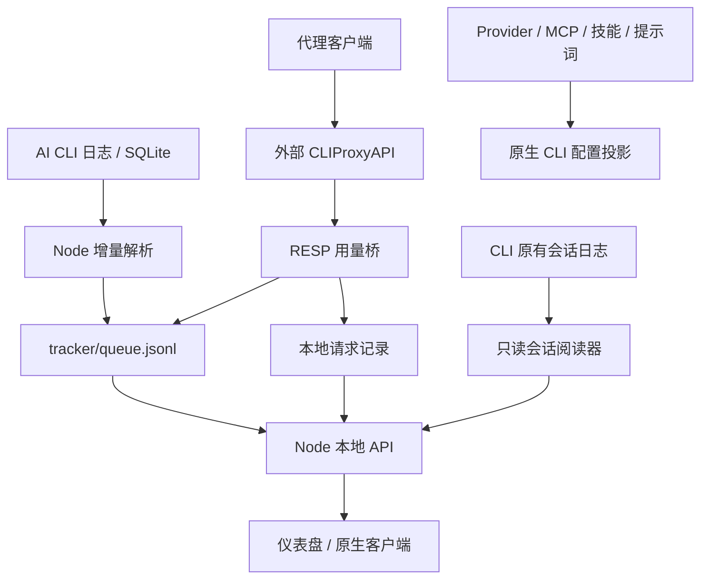

<div align="center">

# AiTool

**English** · 简体中文

### 一个工具箱搞定 AI 编码工作流 —— 多提供商 AI 网关 + Token 用量仪表盘，合一的本地应用。

AiTool 把三个开源项目融合为一个本地优先的产品：

- **AI 代理**（来自 [EasyCLIProxyAPI](https://github.com/router-for-me/EasyCLIProxyAPI) / [CLIProxyAPI](https://github.com/router-for-me/CLIProxyAPI)，MIT）—— 在本地运行网关，把你的服务提供方账号通过 OpenAI / Anthropic / Gemini 兼容端点暴露出去，并记录每次请求的用量。
- **Token 用量分析**（来自 [TokenTracker](https://github.com/xiufengsun/TokenTracker)，MIT）—— 本地优先的仪表盘，追踪 45 款 AI 编码工具的 Token 用量与成本。
- **供应商配置管理**（来自 [cc-switch](https://github.com/farion1231/cc-switch)，MIT）—— 管理 10 款 CLI 工具的供应商预设、原生配置或启动方案，提供共享 MCP / 技能、提示词、配置快照、诊断、分发与额度查询；另有 9 款工具的只读会话历史，无需手改 JSON / TOML。

UI 全程使用 TokenTracker 的设计语言 —— 一个仪表盘覆盖两个世界：代理请求会汇入与原生 CLI 工具相同的趋势、模型分解和成本视图。

</div>

---

本仓库是 `rijing-joker/AITool` 的个人 fork，当前按 `dev` 分支维护，不执行版本升级、npm 发布或桌面发布。旧目录名、环境变量和数据路径保留兼容。

[项目架构与能力矩阵](./docs/architecture.md) · [文档索引](./docs/README.md) · [运行指南](./docs/running.md) · [隐私说明](./docs/PRIVACY.md)

## 融合方式



core 保持为外部独立进程，`core-version.txt` 当前固定 **v8.0.37**；版本 pin 更新不等于自动替换本机已安装 core。用量桥把每个成功的代理请求折叠进 TokenTracker 的半小时桶，因此**代理用量会自动出现在标准仪表盘** —— 趋势、模型分解、成本、热力图 —— 与 Claude Code、Codex、Gemini 等原生工具并列。

## 快速开始

环境要求：当前依赖需 Node.js **22.19+**，开发和测试推荐 **Node 24**（包元数据仍声明 ≥20，不能据此运行最新依赖）。代理 core 额外支持 macOS / Linux / Windows（自动获取 Go 构建的二进制）。

### AiTool 桌面壳（macOS 本地构建）

```bash
npm ci
npm ci --prefix dashboard
npm run dashboard:build
npm ci --prefix desktop
npm --prefix desktop run build
open desktop/src-tauri/target/release/bundle/macos/AiTool.app   # macOS；同时产出 .dmg
```

原生窗口 + 系统托盘（打开 / 启动代理 / 停止代理 / 退出）。壳会自动挑空闲端口、拉起 Node 服务，等本地服务响应后打开仪表盘；关窗隐藏到托盘，退出时一并停掉服务与代理 core。这个壳运行时需要本地仓库和 Node，不打包运行时；TokenTracker 的 macOS/Windows/Linux 应用另有 `EmbeddedServer/`。详见 [desktop/README.md](./desktop/README.md) 和 [运行指南](./docs/running.md)。

### 终端方式

```bash
npm install                # 根目录 CLI + 依赖
npm --prefix dashboard install
npm run dashboard:build

node bin/tracker.js proxy install    # 获取钉住版本的 CLIProxyAPI core（或：AITOOL_CORE_BIN=/path/to/cli-proxy-api node bin/tracker.js proxy install）
node bin/tracker.js serve            # 仪表盘 http://localhost:7680 —— 代理随之启动
```

在仓库中使用 `node bin/tracker.js <命令>`；可选执行一次 `npm link` 后，`aitool` 命令才会加入 PATH。然后通过 CLI 管理代理：

```bash
aitool proxy status     # core + 桥接状态
aitool proxy start      # 启动 core + 用量桥
aitool proxy stop
aitool proxy config     # 显示路径与端点
```

### Docker

```bash
docker compose up -d --build
# 仪表盘：http://127.0.0.1:7680 —— AI 代理：http://127.0.0.1:8318
```

一个容器运行仪表盘 + 本地 API 和 AI 代理 core（钉住版本的 CLIProxyAPI 二进制在构建时按镜像平台预下载）。数据保存在命名卷中，对应 `~/.tokentracker` 与 `~/.aitool`。端口默认只发布到宿主机**回环地址** —— 本地 API 免登录且信任回环 Origin，未经认证反向代理切勿发布到公网接口。容器内一切通过 `AITOOL_BIND_HOST` 绑定 `0.0.0.0`；裸机运行时默认仍是 `127.0.0.1`。

## 供应商配置管理（来自 cc-switch）

[cc-switch](https://github.com/farion1231/cc-switch) 配置文件模块的 Node 移植。按工具保存命名的供应商预设，在仪表盘的**供应商配置**页（侧边栏 → AI Proxy 分组）一键切换 —— 不用手改 JSON / TOML / env 文件。

支持 Claude Code、Codex CLI、Gemini CLI、Antigravity CLI（`agy`）、Grok Build、OpenCode、OpenClaw、Hermes、Pi 和 MiniMax Code。Antigravity CLI 使用独立供应商启动目录，Key 只传给子进程，MCP、Skills 和提示词共享 `~/.gemini/config`；官方账号绑定、切换目前需要 macOS，逐账号额度查询和删除已保存账号不会改动当前登录。

桌面托盘的「切换供应商」打开共用快捷面板，沿用配置备份和冲突处理。额度扩展包括智谱/Z.ai 套餐及余额回退、使用独立 AK/SK 的火山套餐查询；OpenCode Go、Command Code 的 Key 可在额度页本地保存。

| | |
| --- | --- |
| **覆盖工具** | Claude Code · Codex CLI · Gemini CLI · Antigravity CLI · Grok Build · OpenCode · OpenClaw · Hermes · Pi · MiniMax Code |
| **切换模型** | 最小补丁投影（cc-switch 的"关键字段"表）：只写入供应商的关键字段 —— 地址、凭据、模型名；用户自有内容（hooks、permissions、注释）一律不动，上一家供应商的残留仅在未被改动时清除 |
| **编辑器** | 添加/编辑弹窗显示切换到该供应商之后的完整配置文件（cc-switch 的编辑器视图）；保存时关键字段写回供应商行，其余改动经三方比对写入本机配置文件（保留我的 / 保留对方的） |
| **Codex 凭据** | 中转密钥写入 `config.toml` 中 `[model_providers.custom]` 的 `experimental_bearer_token` —— Codex CLI 0.149+ 不再从 `auth.json` 读取中转密钥，`auth.json` 只保存官方 ChatGPT 登录（添加/编辑弹窗的 Codex 编辑器相应拆分：`auth.json` JSON + `config.toml` TOML） |
| **Codex 模型** | 模型选择、能力预览与已有覆盖保留；上下文窗口、速度层级、自动审查模型、默认子代理模型和推理强度随供应商管理 |
| **MCP 服务器** | 页面的 MCP 标签维护一份所有 agent 共用的 MCP 服务器列表（cc-switch 的统一 `mcp_servers` 模块），按应用开关即投影进对应应用的原生 MCP 配置 —— Claude（`~/.claude.json`）、Codex（`config.toml` 的 `[mcp_servers.*]`）、Gemini（`settings.json`）、Antigravity（`~/.gemini/config/mcp_config.json`）、Pi 1.0+（`~/.pi/agent/mcp.json`）、Grok Build、OpenCode、Hermes、MiniMax Code（`~/.minimax/mcp.json`），并可从各工具已配置的服务器导入 |
| **提示词** | 页面的 Prompts 标签维护按应用命名的提示词列表（cc-switch 的提示词模块）；启用某条提示词即覆写对应应用的指令文件 —— `~/.claude/CLAUDE.md`、`AGENTS.md`（Codex、Grok Build、OpenCode、OpenClaw、pi、mcode）、`~/.gemini/GEMINI.md`、`~/.hermes/SOUL.md`（agy 共用 `~/.gemini/config/AGENTS.md`）—— 并先把现有文件内容捕获进存储，手写的指令文件不会被悄悄覆盖 |
| **额度查询** | Base URL 命中受支持套餐供应商的卡片会显示各窗口「剩余百分比」（cc-switch 的 coding_plan 额度服务）；内置 Claude Code / Codex 的 Command Code 预设，查询使用该供应商行自己的密钥访问其 `/alpha` 控制面 |
| **技能与方案** | 共享技能、每应用快照和多应用组合方案；应用前预检，按应用返回结果，失败保留恢复清单 |
| **诊断与分发** | 比较受管字段摘要，修复前预览；显式显示配置内容；按归属分发原生子代理文件、项目技能与 MCP，保留用户修改 |
| **安全性** | 原子写入（凭据文件 0600）、每文件首次写入前自动备份（可在仪表盘恢复）、配置文件编辑器内置于添加/编辑弹窗；Codex 官方 ChatGPT 登录在切向第三方中转时自动暂存、切回时还原 |
| **存储位置** | `~/.aitool/provider-switch/` —— providers、MCP、技能、提示词、方案、官方登录暂存、备份及恢复/分发回执；各应用支持范围见能力矩阵 |

## AI 代理能力（来自 EasyCLIProxyAPI）

凭据页支持按运行索引单个/批量刷新 OAuth、批量启停/删除、逐项结果和问题筛选，并提供单凭据重试/错误规则、xAI 模式及受支持插件的额度查询。服务在自有核心异常退出后有限重试，手动停止或重启会取消旧恢复任务。原生窗口隐藏后暂停仪表盘轮询，后台采集继续运行。

通过仪表盘的 **AI Proxy** 页（标签页）或 core 的管理 API 管理：

| 功能 | 页面标签 |
| --- | --- |
| core 生命周期（启动 / 停止 / 健康检查 / 版本） | Overview |
| 客户端访问密钥（`access.api-keys`） | Access Keys |
| 兼容端点 —— `/v1/chat/completions`、`/v1/messages`、`/v1beta/models` | Access Keys |
| 服务提供方凭据文件（上传 / 列表 / 删除 / 刷新） | Providers |
| 请求级用量记录（模型、提供商、Token、延迟、失败）+ 成本估算（models.dev 定价同步） | Requests |
| 通过 core 管理 API 编辑 `config.yaml` | Settings |
| 随仪表盘自启动 | Settings |

磁盘布局：`~/.aitool/proxy/` —— `bin/`（core）、`config.yaml`、`auths/`（提供方凭据）、`usage/`（请求级记录 + 桶状态）、`logs/core.log`。

用量桥忽略 RESP 的 `support_refresh` 等控制通知。启动时会备份并清理旧版本误记的通知，再向统计队列追加修正累计值；真实零 Token 请求保留。手动执行前先停掉共用这些数据目录的实例，然后运行 `node bin/tracker.js proxy repair-usage`。重复修复安全，不调用 AI 服务。

默认端点：`http://127.0.0.1:8318`（仅本机回环；端口可在 config.yaml 修改）。明文管理密钥保存在 `~/.aitool/proxy/settings.json` —— core 首次加载时会把自己配置里的副本哈希掉。

可选接入还包括 Copilot CLI / VS Code、WorkBuddy / Zed 客户端连接，以及独立的 Magpie / WorkBuddy 订阅上游、搜索/视觉 MCP 和 `aitool/auto` 路由。发现、登录、工具调用及意图分类有显式入口，费用与请求正文发送范围见[整合指南](./docs/magpie-integration.md)及[隐私说明](./docs/PRIVACY.md)。

## Token 用量分析（来自 TokenTracker）

| | |
| --- | --- |
| **支持的 AI 工具数** | **45** |
| **仪表盘** | localhost:7680 —— 趋势、模型分解、成本、热力图 |
| **代理用量来源** | `cliproxy` —— 自动汇入同一批视图 |
| **CLI 会话历史** | `/cli-sessions` —— 只读 Claude Code / Codex / Gemini / Antigravity CLI / OpenCode / Hermes / Grok Build / Pi / MiniMax Code 会话，附逐模型成本估算；Antigravity 只有二进制记录时提供恢复命令 |

并入的 TokenTracker CLI 全部功能继续可用：45 款 AI 编码工具（Claude Code、Codex、Gemini、Cursor、Droid、Cline、Command Code、TRAE 等）的增量统计、按需 hook 或被动 JSONL/SQLite 扫描、成本引擎、sessions、限额、成就、技能面板、桌面宠物和小组件 —— 同一个仪表盘在 `localhost:7680`。代理用量以 `cliproxy` 来源出现在同一批视图中。

```bash
aitool            # 打开仪表盘
aitool sync       # 解析本地日志；有账号凭据时请求单次上传
aitool status     # hook 挂接状态
aitool doctor     # 健康检查
```

## 项目结构

```
bin/tracker.js → src/cli.js       CLI 命令入口
src/lib/local-api.js             /functions/* + /api/{proxy,provider-switch,cli-sessions}/*
src/lib/rollout.js               45 款工具增量解析、去重与 Token 归一化
src/commands/sync.js             数据采集、历史修复、游标与上传同意
src/lib/proxy/                  core 生命周期、v8 管理、用量桥与 models.dev 估价
  extensions/ + opencode-free/   可选适配、搜索/视觉与自动路由
src/lib/provider-switch/        10 款 CLI 配置、MCP、技能、提示词、方案与恢复
src/lib/sessions.js              正文阅读、路径与 revision 校验
src/lib/session-sources.js       另六款正文来源，共九款
src/lib/session-transcript-cache.js  有界内存缓存与长字段分页
dashboard/src/pages/            代理、配置、正文阅读和统计页面
dashboard/src/content/copy.csv  用户文案注册表
desktop/                       依赖本地仓库的 Tauri 壳（macOS app/dmg）
TokenTrackerBar|Win|Linux/      自带 EmbeddedServer 的平台应用
scripts/fetch-core.cjs          外部 core 安装；core-version.txt 固定 v8.0.37
docs/README.md + architecture.md  文档索引与架构/支持矩阵
Dockerfile + docker-compose.yml  仅宿主回环发布的容器与挂载配置
```

## 第三方项目

- [TokenTracker](https://github.com/xiufengsun/TokenTracker)（MIT）—— 作为基座并入：CLI、仪表盘、设计系统。
- [EasyCLIProxyAPI](https://github.com/router-for-me/EasyCLIProxyAPI)（MIT）—— GUI-over-core 架构与功能集的参考；AiTool 用 Node 重新实现了管理层。
- [CLIProxyAPI](https://github.com/router-for-me/CLIProxyAPI)（MIT）—— 代理引擎，运行时作为外部二进制下载（不并入仓库）。
- [cc-switch](https://github.com/farion1231/cc-switch)（MIT）—— 供应商预设 / 配置文件切换模块的参考；AiTool 用 Node 重新实现（仪表盘供应商配置页）。

- [opencode-free-bridge](https://github.com/azrinaldi/opencode-free-bridge)（MIT，`f3e1c5a`）—— 可选免费模型适配的协议/会话辅助代码，许可保留在 `src/lib/proxy/opencode-free/LICENSE`。
- [Magpie](https://github.com/yetone/magpie) 与社区 WorkBuddy 适配（MIT）—— 可选接入、工具和路由参考/改编代码，许可保留在 `src/lib/proxy/extensions/LICENSE.*`。

## 许可证

MIT —— 见 [LICENSE](./LICENSE)（来自 TokenTracker）及 [THIRD_PARTY_NOTICES.md](./THIRD_PARTY_NOTICES.md) 的代码/资源归属说明。
