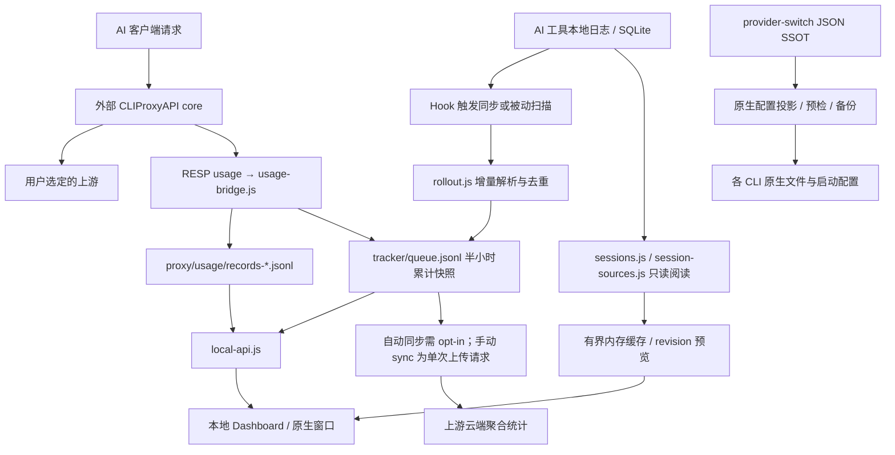

# AiTool 项目架构与能力矩阵

核对日期：2026-10-23。本文描述当前工作区实现，包括尚未提交的改动；历史调研与测试记录见[文档索引](README.md)。项目约定以 [CLAUDE.md](../CLAUDE.md) 为准。

## 项目定位

AiTool 是本地优先的 AI 工具箱，整合 TokenTracker 用量分析、EasyCLIProxyAPI/CLIProxyAPI 代理管理和 cc-switch 配置管理。CLI Sessions 是独立的本地只读会话阅读功能。

本仓库是 `rijing-joker/AITool` 的个人 fork，当前在 `dev` 维护，应用版本为 `0.1.0`；不升级版本或执行发布。`TokenTracker*` 目录、`TOKENTRACKER_*` 环境变量和 `~/.tokentracker` 路径保留兼容，不应批量重命名。上游网站与 npm/桌面发行渠道不代表本 fork 的部署。

## 技术与进程边界

| 层 | 实现与入口 | 边界 |
| --- | --- | --- |
| CLI / 本地 API | CommonJS；`bin/tracker.js` → `src/cli.js`；`src/commands/serve.js` | 当前依赖需 Node ≥22.19，开发/CI 推荐 Node 24；包元数据仍声明 ≥20 |
| Dashboard | React 18、Vite 7、ESM、严格 TypeScript 配置、Tailwind 3；`dashboard/src/App.jsx` | 同时包含 JSX/JS 与 TS/TSX；构建到 `dashboard/dist/`，由本地服务提供 |
| AI Proxy 管理层 | `src/lib/proxy/` | Node 管理配置、进程、凭据和用量；推理由外部 Go core 执行 |
| CLIProxyAPI core | `core-version.txt` 固定 **v8.0.37**；`scripts/fetch-core.cjs` 下载 | 独立进程，HTTP Management API 与 RESP `SUBSCRIBE usage`；pin 更新不自动替换现有安装 |
| 配置管理 | `src/lib/provider-switch/` | 本地 JSON SSOT → 各客户端原生配置；保留用户字段和恢复副本 |
| 可选接入层 | `proxy/opencode-free/`、`proxy/extensions/` | 本地适配服务与受管上游组；发现、登录和工具能力需显式启用 |
| 云功能 | `dashboard/src/lib/insforge*`、`dashboard/edge-patches/` | 上游账号、排行榜和可选统计同步；不承载本地配置/会话阅读 |

core 不链接或内嵌进 npm/原生客户端；Docker 在镜像构建时单独下载并暂存二进制。`AITOOL_CORE_BIN` 可指定现有二进制，`proxy install --local <checkout>` 可用 Go 构建本地 core。

## 数据流

主队列是 `~/.tokentracker/tracker/queue.jsonl`。按 UTC 半小时分桶，追加累计快照，读取时对 `(source, model, hour_start)` 取最后一条。代理成功请求以 `source: "cliproxy"` 进入同一队列；`proxy/usage/buckets.json` 保存连续累计状态，避免重启重复计数。代理请求记录与原生日志都可能记录同一次推理，不能把所有来源简单视为互不重叠的账单。

`project.queue.jsonl`、`session.queue.jsonl` 是本地项目/会话侧表，不参与云上传；`auto-outcomes.jsonl` 的保守 Git 归因也只在本地计算。CLI Sessions 正文仅用于本地读取、有界内存缓存及显式 Markdown 导出，不写进统计队列或正文磁盘缓存。

## 功能覆盖

统计工具清单以 `src/commands/init.js` 的 `SUPPORTED_PROVIDERS` 为准，当前 **45 款**。统计支持不等于都需要 hook，也不等于都支持配置切换、MCP 或正文阅读。

配置/阅读支持来自 `provider-switch/store.js`、`paths.js`、`mcp.js`、`skills.js`、`prompts.js`、`sessions.js` 和 `session-sources.js`：

| 客户端 / app ID | Provider 配置或启动目标 | MCP | 共享技能 | 提示词 | CLI Sessions |
| --- | --- | --- | --- | --- | --- |
| Claude Code / `claude` | `~/.claude/settings.json` | 是 | 是 | 是 | 是 |
| Codex / `codex` | `~/.codex/config.toml` + `auth.json` | 是 | 是 | 是 | 是 |
| Gemini / `gemini` | `~/.gemini/.env` | 是 | 是 | 是 | 是 |
| Antigravity CLI / `agy` | 每 provider 的私有启动目录；账号/模型绑定 | 是 | 是 | 是 | 是；仅二进制记录时提供恢复命令 |
| Grok Build / `grokbuild` | `~/.grok/config.toml` | 是 | 是 | 是 | 是 |
| OpenCode / `opencode` | `~/.config/opencode/opencode.json` | 是 | 是 | 是 | 是 |
| OpenClaw / `openclaw` | `~/.openclaw/openclaw.json` | 无投影 | 无此共享技能投影 | 是 | 无此正文读取器 |
| Hermes / `hermes` | `~/.hermes/config.yaml` | 是 | 是 | 是 | 是 |
| Pi / `pi` | `~/.pi/agent/models.json` | Pi 1.0+ | 是 | 是 | 是 |
| MiniMax Code / `mcode` | `~/.minimax/config.yaml` | 是 | 是 | 是 | 是 |

MCP 共九个客户端投影目标。Pi 使用 `~/.pi/agent/mcp.json`，停用只改 `enabled` 并保留 Pi 设置；agy 的 MCP/技能/提示词共享 `~/.gemini/config`。单工具过滤仅支持 Claude、Codex、Gemini、OpenCode、Hermes。MCP 检查执行初始化和 `tools/list`，不调用工具；检查需用户触发，有超时、分页与取消。

## 配置写入与恢复

- Claude/Codex/Gemini 通过 floor 字段最小补丁切换；其他客户端使用各自的原生结构或 additive slot。断开时，用户编辑过的 slot 和必要指针保留。
- 添加/编辑窗口显示切换后的完整配置；floor 字段保存回 provider，其余编辑写入 live 文件，并用三方冲突检查处理并发修改。
- Codex 中转密钥在 `[model_providers.custom].experimental_bearer_token`；`auth.json` 只保存官方登录，第三方切换暂存官方身份，切回恢复。模型目录、上下文窗口、速度层级、自动审查模型和默认子代理参数独立管理。
- 诊断基于受管字段摘要；修复预览默认仅返回路径与变化状态，主动显示内容才返回配置全文。配置写入成功但诊断回执失败时返回警告，保留真实 current 状态。
- Profiles 保存每应用快照；多应用 bundle 先预检，再分项应用。部分失败时清除当前方案标记并保留实际文件与清单，不假设跨文件事务成功。
- 项目技能/MCP 与原生子代理分发核对 revision、hash 和归属，不覆盖用户修改；技能保留执行位，配置与备份采用私有权限；`.gitignore` 只更新受管区块。
- `profile-recovery/`、`distribution-backups/` 默认保留最近 20 次已完成尝试且最长 30 天；活动、不确定或仍被回执引用的副本保留。恢复需核对 manifest 与现文件，不能整目录覆盖用户后续修改。

Antigravity 官方多账号切换目前仅 macOS 支持；额度查询和删除保存账号不替换实时登录。无法解码原钥匙串登录时拒绝切换。API-key 启动用私有 profile 和子进程环境传递密钥。

## 会话读取与估价

`sessions.js` 负责 Claude/Codex/Gemini，`session-sources.js` 扩展 agy/OpenCode/Hermes/Grok Build/Pi/MiniMax。路径、真实目标、数据库/WAL 和伴随文件按应用根目录校验。Codex 合并线程分页和压缩日志，revision 仅包含选中线程及声明的 fork 父页；未解析完成的 replay 不缓存。

阅读器按用户问题组织轮次，呈现工具结果与 diff，支持筛选、目录定位、搜索和导出；列表/轮次虚拟化。进程 LRU 最多 8 个会话、96 MiB。长正文、思考、工具参数、结果和补丁使用带 revision 的预览引用；内容接口每页最多 128 Ki 字符。日志变化需重新加载，搜索/导出加载完整 revision，不导出截断预览。

| 估价用途 | 来源 | 实现 |
| --- | --- | --- |
| Tokens / 统计聚合页 | curated overrides + 本地价格源；对应云端 edge 定价块 | `src/lib/pricing/index.js`、`curated-overrides.json` |
| Proxy Requests / CLI Sessions | models.dev，24 小时 TTL，读取时后台刷新，失败退避 5 分钟 | `src/lib/proxy/pricing.js` |

费用按 input/output/cache creation/cache read 和适用的 reasoning 计价，不能用 `total_tokens` 代替。OpenAI/Gemini 的 input 通常包含 cache read，Claude 为 fresh input；代理按 `executor_type` 归一化。两套价格可能不同；未知价格与 models.dev 估价不代表真实订阅积分。Proxy Overview 不显示费用。

## API 与页面定位

| 接口 | 消费页面 / 用途 | 服务实现 |
| --- | --- | --- |
| `/functions/tokentracker-*` | Tokens、Sessions 元数据、Limits、Skills 等统计能力 | `src/lib/local-api.js` |
| `/api/proxy/*` | `/proxy` 七标签：overview / upstreams / providers / keys / aliases / requests / settings | `src/lib/proxy/api.js` |
| `/api/provider-switch/*` | `/provider-switch`：providers、MCP、skills、prompts、profiles、诊断、分发 | `src/lib/provider-switch/api.js` |
| `/api/cli-sessions`、`/list`、`/read`、`/content` | `/cli-sessions` 只读正文；不同于统计 Sessions 页 | `src/lib/local-api.js`、`sessions.js` |
| `/api/health` | 本地服务存活检查，不拉起 core | `src/lib/local-api.js` |
| `/api/local-auth` | 本地浏览器/原生壳取得变更授权 token | `src/lib/local-api.js` |
| core `/v0/management/*` | provider groups、OAuth 凭据、key、设置 | `src/lib/proxy/management.js` → core |
| core `/v1/chat/completions`、`/v1/messages`、`/v1beta/models` | 客户端兼容推理入口 | core，默认 `127.0.0.1:8318` |

本地 API 默认绑定回环，读取接口按本机信任模型开放；配置变更要求本地 token 和允许的 loopback Origin。core 管理 API 使用独立 Bearer key，明文留在 `proxy/settings.json`，core 对 `config.yaml` 中的副本做哈希。配置保存通过强 ETag/If-Match，冲突保留草稿。

## 运行形态

| 形态 | 端口/资源 | 说明 |
| --- | --- | --- |
| `node bin/tracker.js serve` | 默认 :7680；读 `dashboard/dist/` | 启动本地 API，按 autoStart 拉起代理/bridge；`--no-sync` 只跳过初始同步 |
| `npm run dashboard:dev` | :5173，冲突可换端口 | Vite 混合 local/mock 分析中间件；不启动代理/配置/正文后端，未处理 `/functions/*` 可转发 :7680 |
| `desktop/` | 尝试 :7680–7687 | Tauri 窗口/托盘；依赖 checkout 和 Node，当前 bundle targets 为 macOS app/dmg |
| `TokenTrackerBar/` | :7680 | Swift 菜单栏、WidgetKit、桌宠；独立 `EmbeddedServer/` |
| `TokenTrackerWin/` | 优先 :17680，空闲端口回退 | .NET 8、WebView2、托盘、桌宠、额度组件、OAuth bridge；独立 `EmbeddedServer/` |
| `TokenTrackerLinux/` | 优先 :17680，空闲端口回退 | Tauri/WebKitGTK，AppImage/deb/rpm；独立 `EmbeddedServer/`，桌宠用 X11/XWayland 子进程 |
| Docker | 容器内 `0.0.0.0`，宿主默认仅回环映射 | Node 22 镜像 + core；命名卷看不到宿主 CLI 历史，需按工具挂载源目录 |

`desktop/` 等待本地状态接口响应，不保证 core 已健康；`AITOOL_ROOT`/`AITOOL_NODE` 是运行时覆盖。Windows/Linux OAuth 通常要求固定 :17680，回退端口不能假设 OAuth 仍可用。`native:visibility` 暂停隐藏页面轮询，`native:providers` 打开页内快捷切换，不重载并丢失草稿。

## 可选接入与隐私边界

OpenCode free adapter、Magpie/WorkBuddy 订阅接入、Copilot/WorkBuddy/Zed 客户端连接、搜索/视觉 MCP 和 `aitool/auto` 路由均有显式入口。普通 integration status 不运行发现、MCP、登录或订阅额度刷新。受管 adapter 使用独立本地 key 和受管 ETag provider group。

代理会把推理正文发给用户选定的上游；搜索/视觉工具可把查询、结果片段或图片发给配置的服务；开启意图分类会额外发送有限用户文本片段。用量/路由事件不保存这些正文。分类与实际推理各计量一次，外层自动路由清除 usage 防止重复入账。路由管理快照共享 5 秒，已有成功快照可容忍最长 30 秒的读取失败；额度缓存 30 秒，事件写盘不阻塞响应。

自动云上传默认关闭且无法确认偏好时拒绝上传；手动 `aitool sync` 是单次上传请求。云端统计不接收本地路径、项目侧表、会话正文、provider 预设或原始请求记录。遥测开关与云同步开关独立；Skills 页在登录且云同步开启时可发布不含正文/绝对路径的技能元数据清单。凭据/提示词/恢复文件仍可能含敏感本地内容；显示隐私模式不改变原始文件或显式复制/导出。完整说明见 [PRIVACY.md](PRIVACY.md)。

## 修改入口与验证

先看 `src/cli.js`、`src/lib/local-api.js`、对应后端模块，再看 `dashboard/src/lib/*-api.ts` 和 `dashboard/src/pages/`。用户文案来自 `dashboard/src/content/copy.csv`；`NativeAuthCallbackPage` 必须 eager import。

新统计工具需同步 parser、sync/status/init 与定价语义。统计定价修改需保持五份 edge 块一致；代理估价是另一套系统。后端用 `npm test` 或相关 `node --test test/<name>.test.js`；前端用 Vitest、文案/语言/硬编码/架构校验、TypeScript 检查和构建。命令见 [CONTRIBUTING.md](../CONTRIBUTING.md)。纯文档变更核对路径、脚本、接口、清单与链接，不把历史报告的测试次数当成本次执行结果。
