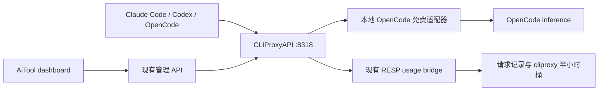

# OpenCode 免费模型反代调研与 AiTool 接入方案

调研日期：2026-10-16（北京时间）。下文保留原始调研和方案，产品实现及最新验证见末尾「落地实现」。验证使用隔离实例，没有修改现有代理实例或 AI CLI 配置。

## 结论

AiTool 可以沿用现有 CLIProxyAPI 核心，在它后面接一个仅监听本机的 OpenCode 免费模型适配器。推荐以 **azrinaldi/opencode-free-bridge** 为第一版参考：MIT、CommonJS、Node 标准库、专注于一个 OpenAI-compatible 上游，能直接接到现有 `openai-compatibility` 分组。

如果希望先使用现成的独立 Go 服务，**jasonxu114514/opencode2api** 是功能更完整的候选，有多平台发行版、匿名通道和三协议支持。它的许可证是 GPL-3.0；应作为独立服务经 HTTP 接入，涉及源码合并或分发时需要另行核对许可证要求。

免费层目前有客户端校验和容量限制。普通 OpenAI 请求不能仅凭 `Bearer public` 调通；模型出现在 `/models` 里也不代表推理可用。接入应标为可选功能，不承诺“无限免费”。

## GitHub 候选

Star 数和最近提交均为调研时快照。功能说明来自 README 与源码，只有下文列出的链路做过实测。

| 项目 | Star | 技术 / 许可证 | 运行方式与判断 |
| --- | ---: | --- | --- |
| [jasonxu114514/opencode2api](https://github.com/jasonxu114514/opencode2api) | 837 | Go / GPL-3.0 | 直接代理 Zen / Go；匿名通道、Chat / Responses / Messages、动态目录、key 池、管理页；适合外部服务接入。最新发行版为 v1.4.0，2026-10-15 发布，提供 macOS / Linux / Windows、amd64 / arm64。 |
| [TiaraBasori/OpenCode2API](https://github.com/TiaraBasori/OpenCode2API) | 353 | Node ESM / MIT | 包装真实 OpenCode 运行时，管理后端和会话，并用插件控制内置工具；提供三种 API，但增加 OpenCode 安装、会话清理和本地历史管理成本。 |
| [bigdata2211it-web/opencode-free-proxy](https://github.com/bigdata2211it-web/opencode-free-proxy) | 120 | Node / 未声明许可证 | 小型 HTTP 反代，最近提交停在 2026-05-18；免费层随后发生多次变化，复用与兼容性依据不足。 |
| [6Kmfi6HP/opencode2api](https://github.com/6Kmfi6HP/opencode2api) | 80 | Go / All rights reserved | API 与兼容性研究较多，但当前 LICENSE 明确不授予使用、复制、修改或分发许可，不能按开源项目集成。 |
| [12errh/zen-proxy](https://github.com/12errh/zen-proxy) | 49 | Node ESM / MIT | 三协议、Claude 启动器、免费模型回退、自带界面；可独立接入，但与 AiTool 重叠较多。存在可选的系统前缀与工具映射，当前系统前缀默认关闭，采用时需检查配置与工具兼容性。 |
| [azrinaldi/opencode-free-bridge](https://github.com/azrinaldi/opencode-free-bridge) | 25 | Node CommonJS / MIT | 对外提供 Chat Completions；内部选择 Chat / Responses，维护会话、工具名映射和动态模型列表；与 AiTool 现有核心最容易衔接。项目创建于 2026-10-13，维护历史较短。 |

本次审阅的提交：

- opencode-free-bridge：[`f3e1c5a`](https://github.com/azrinaldi/opencode-free-bridge/tree/f3e1c5a8a046f5808693d849bc55be7b4f41a39a)，package version 1.5.3。
- jasonxu114514/opencode2api：[`a6601da`](https://github.com/jasonxu114514/opencode2api/tree/a6601da673c03832bf78ce04b100dee8c8a92385)。审阅的是此提交，未实测其 v1.4.0 发行二进制。
- TiaraBasori/OpenCode2API：[`2be4813`](https://github.com/TiaraBasori/OpenCode2API/tree/2be4813d10790360ed6623f92bedd2159b2bd133)。
- 12errh/zen-proxy：[`1387ec6`](https://github.com/12errh/zen-proxy/tree/1387ec607565e5e52d7c0be59bb838815a0c7023)。
- 6Kmfi6HP/opencode2api：[`0b4e602`](https://github.com/6Kmfi6HP/opencode2api/tree/0b4e60202c784c85ed49799746df9453e9ae7fa8)。

## 当前上游接口和免费目录

[官方模型文档](https://opencode.ai/docs/zen/)与 [models.dev](https://models.dev/api.json) 给出的 OpenAI 数据面是：

```text
https://opencode.ai/inference/openai/v1/chat/completions
https://opencode.ai/inference/openai/v1/responses
```

目录从 `https://opencode.ai/inference/v1/models` 读取。本次旧 `/zen/v1/models` 同样返回 200，但目录成功不能证明旧推理路径可用。候选项目中仍有默认 `/inference/v1/chat/completions` 的写法；集成时应按最新官方文档配置，不能只复制 README 的旧地址。

实时目录返回 88 个模型。与 OpenCode 元数据交叉检查“输入/输出价格均为 0、未 deprecated、仍在实时目录”后，得到 11 个普通文本/工具模型：

```text
big-pickle
cat-jam-free
deepseek-v4.1-flash-free
glm-5.3-flash-free
ll-alpha-free
longcat-2.5-preview-free
mimo-v2.6-flash-free
muse-spark-1.3-contributor-free
nemotron-3.5-lightning-free
nemotron-3.5-super-vl-free
space-bunny-free
```

这份列表是目录快照，只有 `big-pickle` 做过推理验证。需要避免仅按 `-free` 后缀导入全部目录：`jev-1.13-free` 使用 System One 协议；`muse-spark-1.2-contributor-free` 仍出现在目录但元数据标记 deprecated；`nemotron-3-ultra-free` 仍有零价元数据但已不在实时目录。

官方 OpenCode 源码确认匿名模式使用 `public` 占位凭证，并携带会话、client、project 等请求头。免费层的最新校验在 inference 服务中，公开仓库不能完整解释其接受条件。几个反代项目还会适配会话格式、工具定义和上游流式请求，这些实现需随上游变化维护。

官方资料：

- [模型、免费层、隐私说明](https://opencode.ai/docs/zen/)。
- [OpenCode 会话请求构造](https://github.com/anomalyco/opencode/blob/00e7472faa2ef15b30db6110440117e4e7e1a72a/packages/core/src/session/model-request.ts)。
- [旧 Zen 路由到 inference 的转发](https://github.com/anomalyco/opencode/blob/00e7472faa2ef15b30db6110440117e4e7e1a72a/packages/console/app/src/lib/inference-proxy.ts)。

## 已验证的 AiTool 链路

使用当前安装的 CLIProxyAPI **8.0.29 / 5fc580b1**，独立 loopback 端口、临时 auth/config/usage/queue 目录，以及 opencode-free-bridge 审阅提交。适配器的上游 Chat / Responses 地址覆盖为官方 `/inference/openai/v1/*`。测试没有启动真实 Claude Code / Codex CLI。

| 验证项 | 结果 |
| --- | --- |
| 普通匿名请求直连免费 Chat 接口 | HTTP 403，`FreeTierError`，要求在 OpenCode 内使用。 |
| 经适配器请求官方 Chat 接口 | HTTP 200，`big-pickle` 返回 `OK`，含 usage 与流结束标记。 |
| 客户端 → CLIProxyAPI → 适配器，`/v1/chat/completions` 非流式 | HTTP 200，返回 `OK`；usage 为 input 655 / output 19 / total 674。 |
| 同一链路，`/v1/messages` 流式 | HTTP 200，返回 `OK`，Anthropic 事件以 `message_stop` 正常结束，最终 usage 为 input 655 / output 13。 |
| 同一链路，`/v1/responses` 流式 | HTTP 200，返回 `OK`，存在 `response.completed`；input 655，cached 640，output 46（含 reasoning 43），total 701。 |
| 工具调用与工具结果往返 | 两次 HTTP 200，第一次返回 `echo_marker({marker:"AITOOL_TEST"})`，第二次提交 tool result 后返回 `AITOOL_TEST`。本地只回传字符串，没有执行命令或读取用户文件。 |
| AiTool usage bridge | 成功请求保存为 `OpenAICompatExecutor` 记录，并进入 `source: "cliproxy"` 半小时桶。Responses 请求归一化为 fresh input 15 / cached input 640 / output 46 / total 701，reasoning 未重复累加。 |
| opencode-free-bridge 自带离线测试 | 26 项通过，覆盖 HTTP 合约、工具名映射、目录并发合并和 token budget。 |

测试期间出现过本机 Node 自动选择 IPv4/IPv6 时的连接超时；重试后 Responses 成功，工具往返在隔离进程中关闭自动地址族选择后成功。首版应处理网络错误与超时，但不要无条件改变整个 AiTool 进程的 DNS/网络默认设置。这些结果证明接口衔接可行，不代表所有免费模型或完整 CLI 多轮任务都已验证。

还有两个源码层面的差异需要修正：

- 该 bridge 在非流式 Chat 汇总和 Responses → Chat 转换时，只保留基本 input/output/total，部分路径丢失 cache/reasoning 明细。上面的 Responses 成功保留明细，是其内部 Chat SSE 路径的结果，不能推广到 Muse 的原生 Responses 转换。
- bridge 会提高较小的输出预算，还会适配 `tool_choice` 和添加工具定义。产品化前要明确这些变化、验证工具重名和参数映射，并避免把客户端无法执行的占位工具返回给客户端。

## 推荐结构



适配器对核心只需要呈现稳定的 `/v1/models` 与 `/v1/chat/completions`。客户端的 Anthropic / Responses 转换继续由核心承担；Muse 等上游原生 Responses 模型由适配器内部转换到 Chat。这样可复用现有访问密钥、模型别名、请求页、费用估算和 usage bridge。

第一阶段可把现成独立服务加入 **AI Proxy → Upstreams → OpenAI-compatible**。对应核心 v8 分组示例：

```yaml
api-keys:
  openai-compatibility:
    - name: opencode-free
      base-url: http://127.0.0.1:20129/v1
      keys:
        - api-key: public
          proxy-url: direct
      models:
        - name: big-pickle
          alias: big-pickle
```

这里 `public` 是所审阅 bridge 接受的占位值，不是 AiTool 客户端访问密钥。正式适配器应由 AiTool 生成单独的随机内部密钥，核心用它访问适配器，适配器按上游要求处理匿名凭证。上面的模型配置仅用于说明，完整列表应由动态发现后显式选择保存。

将片段合并进已有分组，或使用现有 Upstreams UI；不要整体替换当前 config.yaml，也不要自动开启付费回退。客户端仍指向 AiTool 的 `http://127.0.0.1:8318`，Claude 使用根地址，Codex / OpenCode 使用 `/v1`。

## 具体改动位置

| 模块 | 改动 |
| --- | --- |
| 新 `src/lib/proxy/opencode-free/` | CommonJS 适配器：Chat 合约、模型发现、会话、上游协议选择、SSE 与 usage 转换。可以适配 MIT 参考代码，保留归属与 LICENSE；剔除全局 DNS 设置及安装器行为。 |
| `src/lib/proxy/paths.js` / `config.js` | 增加适配器偏好与状态目录，密钥文件权限 0600；使用 `AITOOL_` 前缀。默认关闭，监听 127.0.0.1，端口可配置或分配后写入对应上游组。 |
| `src/lib/proxy/manager.js` / `src/commands/proxy.js` | 添加适配器生命周期；服务入口保持可独立启动，确保 detached 核心不会指向已随 CLI 命令退出的适配器。核心继续作为外部二进制，不替换或打包它。 |
| `src/lib/proxy/api.js` | 适配器状态、开关和模型刷新 API；写操作继续使用 `isAuthorizedLocalMutation`。使用现有核心 Management API 保存该上游组，保留其他组。 |
| `dashboard/src/pages/upstreams-tab.jsx` / `dashboard/src/lib/easy-providers.ts` | 添加 OpenCode 免费预设或添加入口，使用现有分组编辑、key 编辑和模型选择逻辑。 |
| `dashboard/src/lib/proxy-api.ts` / `dashboard/src/pages/ProxyPage.jsx` | 显示已启用状态、适配器健康、目录更新时间、容量/客户端校验错误；目录存在和推理成功应分别表示。 |
| `src/lib/provider-switch/presets.js` | 添加指向 AiTool 本地代理的 Claude / Codex / OpenCode 免费预设，复用带备份的投影。Codex 继续 `wire_api: responses`，relay key 写 `experimental_bearer_token`，遵循现有 auth stash 逻辑。 |
| `dashboard/src/content/copy.csv` 和 locale 文件 | 新文本来自 copy registry，包括免费层与各模型的官方数据使用说明。 |
| `src/lib/proxy/pricing.js` / `usage-bridge.js` | 主要复用现有链路；适配器完整保留 cache/reasoning 明细、真实模型 ID、usage 尾块、失败和取消语义，未知计数不伪造。 |
| `src/lib/pricing/curated-overrides.json` 和五个 edge 定价块 | 为已确认免费 ID 添加一致的零价条目，解决 Tokens 页对付费同族模型的误匹配；遵循现有 parity 约束。 |

最后一项必须处理。本次用当前定价函数验证：

- Proxy Requests 的 models.dev 价格能把这些免费模型识别为 $0。
- Tokens 的独立 curated/fuzzy 定价把 `deepseek-v4.1-flash-free` 匹配为 DeepSeek 付费价格，把 `glm-5.3-flash-free` 匹配为 GLM 付费价格。
- `big-pickle` 等部分新 ID 在 Tokens 中是 **unpriced**，虽然美元结果也是 0，含义与已确认免费不同。
- queue 上已有 `total_cost_usd: 0` 不能解决此问题；`computeRowCost` 对 `cliproxy` 仍从 token 列和自己的价格表计算。

保留实际 `-free` ID，不给免费请求取付费模型名作为存储型号，也不要把全局所有 `cliproxy` 请求都算成免费。模型目录变动后，退役项停止新请求；历史零价记录应保留正确解释。

## 首版范围与验收

先把 `big-pickle` 的三种客户端 API、流式/非流式和工具往返接入产品，再扩大到实时目录中的 Chat 模型和 Muse Responses 模型。

验收包括：

1. 启用/关闭/重启/异常退出后，核心上游与适配器状态一致；已有上游配置完整保留。
2. Chat、Messages、Responses 的流式与非流式成功、取消、错误、usage 尾块均正确。
3. Claude / Codex / OpenCode 各完成实际多轮工具任务，覆盖同名工具、参数映射、结果回传和客户端不支持的工具。
4. cached input 从 input 中正确拆分，reasoning 只计一次；请求页和 Tokens 页免费费用一致。
5. 模型发现超时、deprecated、协议不支持、429 / FreeTierError 可辨识；禁用隐式付费模型回退。
6. 本地不保存提示词、对话或工具结果；复用现有云同步 opt-in 门禁。

官方对免费模型的数据政策各不相同。例如 DeepSeek / GLM 声明零保留且不用作训练，MiMo 免费期的数据可能用于改进模型，Muse Contributor Free 涉及 prompts/completions 训练用途。AiTool 本地只记 token 不会改变这些上游政策，选模型时需要可见的官方说明。

涉及代码后的检查：针对性 proxy / provider-switch 测试、定价 parity 测试，及 `npm test`；改 dashboard 时再运行 copy、locale、ui-hardcode、guardrails 验证和 dashboard build。本仓库是个人 fork，按 `CLAUDE.md` 不做版本升级、npm 发布或 release dispatch。

## 落地实现（2026-10-17，北京时间）

入口在 **AI Proxy → Upstreams → OpenCode 免费模型**。先启动代理，点击刷新模型，阅读对应模型的数据政策，勾选后启用。模型目录成功与推理成功分别显示，健康状态每 10 秒更新。关闭会移除自己的上游组，再停止适配器；普通代理停止保留启用偏好，下一次启动会恢复。

也可使用 CLI：

```bash
aitool proxy start
aitool proxy opencode-free models
aitool proxy opencode-free enable big-pickle
aitool proxy opencode-free status
aitool proxy opencode-free disable
```

Provider Configs 的 Claude / Codex / OpenCode 均增加了 **AiTool OpenCode 免费**预设。地址读取 AiTool 当前代理端口，默认模型为 `big-pickle`；填写 **AiTool 客户端访问密钥**，再使用原有保存/切换流程。Codex 仍使用 Responses 和 `experimental_bearer_token`，官方登录备份恢复沿用现有逻辑。没有自动修改真实 CLI 配置。

实现分工：

- `catalog.js`：实时目录与 models.dev 交叉核验，1 小时有效期，失败后 1 分钟退避；失败时停止授权新推理。仅支持已有明确零价条目的审阅型号，新型号需一起补充审阅列表、本地定价及五份 edge 表。当前有 9 个在线型号：`beam-free`、`big-pickle`、`deepseek-v4.1-flash-free`、`glm-5.3-flash-free`、`longcat-2.5-preview-free`、`mimo-v2.6-flash-free`、`nemotron-3.5-lightning-free`、`nemotron-3.5-super-vl-free`、`space-bunny-free`。原方案中的 Muse 等型号已不在当前交集内。
- `protocol.js`：从 MIT 参考提交保留纯会话/工具转换函数及 LICENSE，去掉安装器、全局 DNS 修改、旧模型别名和请求日志。仅在内存中缓存会话关联，内容不落盘。
- `server.js`：独立 Chat Completions 服务，上游协议由元数据决定，支持原生 Chat 和 Responses。保留客户端 token 上限和 usage 明细；不切换到其他型号；同名 `read`/`shell` 工具用无冲突别名往返，参数保持原样；新增的占位工具和未知工具绝不返回为可执行调用。工具片段先合并校验，再发给客户端；文本仍逐块流式返回。
- `state.js` / `daemon.js` / `index.js`：默认关闭，固定监听 `127.0.0.1`，随机内部密钥与配置文件权限 `0600`。首次分配端口，随后复用；后台进程不随短 CLI 命令退出。启停经内部认证 HTTP 控制，避免误杀复用 PID。跨进程锁保护开关；管理 API 失败会保留或恢复配置。代理已停止时，关闭功能仅删除 YAML 中自身节点并保留原文件备份。
- 本地 API：`GET /api/proxy/opencode-free`、`POST /api/proxy/opencode-free`（`enabled`、`models`、可选 `port`）及 `POST /api/proxy/opencode-free/refresh`。所有写操作走现有本地认证，状态不包含内部密钥。核心组名为 `aitool-opencode-free`，同名但密钥不匹配时返回冲突，保留其他上游。

配置在 `~/.aitool/proxy/opencode-free/settings.json`，运行位置在 `runtime.json`；`AITOOL_OPENCODE_FREE_DIR` 可指定隔离目录。客户端标识默认取已验证的 `opencode/latest/2.0.29/cli`，上游升级后可通过 `AITOOL_OPENCODE_FREE_USER_AGENT` 覆盖并重启代理。没有更改进程级 DNS 设置。异常退出会显示「已启用 · 适配器已停止」，重新应用选择或启动代理可恢复。

核心启动成功后才恢复免费适配器；适配器启停或分组同步失败会单独输出警告并记录在 `~/.aitool/proxy/logs/dashboard.log`，不阻断其他上游及用量桥接。重启或重新应用选择会保留仍被选中模型的已有别名、模型配置和密钥级模型映射；取消选择时删除该型号的映射，新选型号追加默认映射。

可辨识诊断包括 `client_validation_failed`（401/403 客户端校验）、`capacity_limited`（429）、`catalog_unavailable`、`model_unavailable`、`upstream_timeout`、`upstream_stream_incomplete` 和 `unsupported_upstream_tool`。状态只保留诊断码，不记录可能包含提示词的上游错误原文。

使用本次实现与 CLIProxyAPI 8.0.29 的隔离实测：`big-pickle` 的 Chat / Messages / Responses **流式及非流式六条链路均为 HTTP 200**，返回 `OK`，流正常结束；6 条记录进入 `OpenAICompatExecutor` 和 `cliproxy`，最终桶为 fresh input 1280、cached input 2560、output 98、total 3938，reasoning 没有重复累加。另用真正的控制模块验证了启用、写入核心分组、推理及关闭。当前核心的 Responses 最终 JSON 可能把 reasoning 明细显示为 0，但 RESP 原始记录保留了该明细；此核心行为未在适配器中伪造补值。

另用自定义 `read({marker})` 工具做了真实双轮测试：内部映射为 `read_client`，返回时恢复 `read` 与原参数，提交合成工具结果后模型返回 `AITOOL_TEST`；两轮均为 HTTP 200。测试没有执行工具指令或读取用户文件。

离线测试覆盖目录更新/退役/失败、密钥与选模限制、两种上游协议、usage 尾块、同名工具往返、占位工具拦截、HTTP/SSE 错误、取消、超时、定价一致性，以及真实 detached 进程的启停、异常退出恢复和保存失败处理。Muse 原生 Responses 使用离线事件验证；当前无在线型号可做实测。尚未运行三款真实 CLI 的完整项目任务，协议测试不等于完整 CLI 兼容性认证。

最终检查：`npm test` 4,190 通过、12 跳过、0 失败；`validate:copy`、`validate:locale`、`validate:ui-hardcode`、`validate:guardrails` 和 `dashboard:build` 全部通过。现有 OpenCode 文件重写测试补充了明确变化的夹具修改时间，避免 inode 被复用且时间戳相同导致偶发失败；没有改变解析器逻辑。
