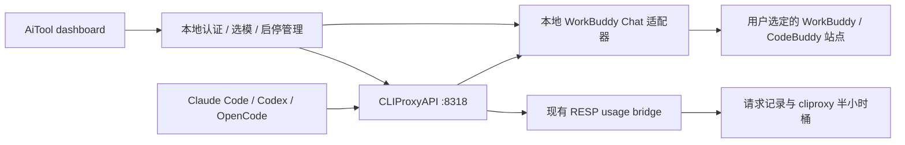

# WorkBuddy 反代调研与 AiTool 接入方案

调研日期：2026-10-18（北京时间）。本次继续此前会话选定的第一个候选项目，完成源码审阅、上游离线测试和隔离协议验证；尚未实现 AiTool 产品入口，也没有登录真实账号或发送真实 WorkBuddy 推理请求。

## 结论

[yuan240324/workbuddy-openai-proxy](https://github.com/yuan240324/workbuddy-openai-proxy) 适合作为 **WorkBuddy/CodeBuddy 认证与 Chat 协议的 MIT 参考实现**。它是零第三方依赖的 Node ESM 服务，具有浏览器授权登录、多站点、多账号池、模型目录、积分查询，以及 Chat Completions / Responses / Anthropic Messages 接口。

AiTool 可以沿用现有 OpenCode 结构：**客户端 → CLIProxyAPI → 本地 WorkBuddy 适配器 → WorkBuddy/CodeBuddy**。本次使用合成上游验证了当前安装的 CLIProxyAPI 8.0.32 能经该项目的 Chat 处理器完成三种客户端协议的流式/非流式请求、双轮工具调用，以及现有 RESP usage bridge 入库。因此无需给核心增加 WorkBuddy executor，首版适配器只需向核心提供 `/v1/models` 和 `/v1/chat/completions`。

**不建议原样搬入整个项目。** 默认上下文裁剪、跨站点回退、扩大输出预算、缺失 usage 时估算，以及错误流的成功收尾，都与 AiTool 当前的准确用量和透明请求语义存在差异。优先提取认证、请求头、目录和纯协议逻辑；修正下文问题后再做内置接入。

## 审阅基线

| 项目 | 本次快照 |
| --- | --- |
| 仓库 | `yuan240324/workbuddy-openai-proxy`，未归档，41 stars |
| 审阅提交 | [`5d8eb743396c875aea136b4df601bf4f7873759f`](https://github.com/yuan240324/workbuddy-openai-proxy/tree/5d8eb743396c875aea136b4df601bf4f7873759f)，提交时间 2026-09-28 07:44:50（北京时间） |
| package version | `1.4.0`，`private: true`，没有声明 npm dependencies |
| Node / 模块格式 | 上游声明 Node ≥18，ESM `.mjs`；AiTool 的 `src/` 为 CommonJS、Node ≥20 |
| 许可证 | [MIT](https://github.com/yuan240324/workbuddy-openai-proxy/blob/5d8eb743396c875aea136b4df601bf4f7873759f/LICENSE)，Copyright (c) 2026 yuan240324；复用实质代码须保留版权与许可 |
| 本次 Node | `v22.21.1` |
| 本次核心 | CLIProxyAPI `8.0.32`，commit `911f49cb`；仓库 `core-version.txt` 固定 `v8.0.32` |

Git clone 连接失败后，改用 GitHub API 按固定提交读取树和 blob，并校验 Git blob SHA-1；匿名 API 限流后使用已有 `gh` 登录读取剩余文件。没有读取 WorkBuddy 客户端凭证。第三方 README 的“实测可用”及模型名称均为第三方声明，不能当成本次真实服务验证。

## 登录、站点和额度

项目采用浏览器授权加轮询的登录流程，没有要求导出浏览器 cookie 或扫描 WorkBuddy 本地数据库。实现见 [device-login.mjs](https://github.com/yuan240324/workbuddy-openai-proxy/blob/5d8eb743396c875aea136b4df601bf4f7873759f/src/device-login.mjs) 和 [auth.mjs](https://github.com/yuan240324/workbuddy-openai-proxy/blob/5d8eb743396c875aea136b4df601bf4f7873759f/src/auth.mjs)。这些路径来自第三方源码，本次没有向真实站点调用：

1. `POST /v2/plugin/auth/state?platform=CLI` 获取 `state` 和 `authUrl`。
2. 用户在浏览器完成授权，服务轮询 `GET /v2/plugin/auth/token?state=...`。
3. 可选读取 `/v2/plugin/login/account?state=...` 补齐账号身份。
4. access/refresh token 保存到 `auth.<site>.pool.json`；同一 uid 更新原账号，兼容旧单账号文件。
5. 临过期前五分钟刷新；`/v2/plugin/auth/token/refresh` 使用 `X-Refresh-Token`，每站点/账号合并并发刷新。聊天请求不携带 refresh token。

[站点预设](https://github.com/yuan240324/workbuddy-openai-proxy/blob/5d8eb743396c875aea136b4df601bf4f7873759f/src/config.mjs#L65) 有三类：

| 站点 ID | 推理/授权 host | 积分查询 host | 解释 |
| --- | --- | --- | --- |
| `cn-cli` | `copilot.tencent.com` | `www.codebuddy.cn` | 国内 CodeBuddy CLI 通道；第三方项目将 WorkBuddy/CodeBuddy 额度包装到此通道，真实账号权限仍需验证 |
| `intl-cli` | `www.codebuddy.ai` | `www.codebuddy.ai` | 国际 CodeBuddy CLI |
| `intl-work` | `www.workbuddy.ai` | `www.workbuddy.ai` | 国际 WorkBuddy |

没有独立的 `cn-work` 预设，不应把国内 CLI 通道与国内 WorkBuddy 的账号、订阅和余额等价视为已验证。不同站点单独登录、保存凭证和查询余额；目录中的模型不代表账号有调用权限。

真实数据面为 `POST /v2/chat/completions`，上游强制流式。请求头包含 Bearer access token、CLI User-Agent、Origin/Referer、request/trace ID、`X-Product`，以及账号 uid/enterprise/domain 字段；见 [headers.mjs](https://github.com/yuan240324/workbuddy-openai-proxy/blob/5d8eb743396c875aea136b4df601bf4f7873759f/src/headers.mjs)。

目录从 `/console/enterprises/personal/models` 获取，过滤 disabled 模型及 CLI agent 的模型权限，保留积分倍率、上下文/输出上限和图片/工具/reasoning 能力。目录失败会保留旧缓存或回退到 `seedModels`；国际 WorkBuddy 尤其依赖静态 seed。AiTool 应显示 `upstream` / `cached` / `seed` 来源及更新时间，分别展示目录发现和推理健康，不承诺静态目录里的模型可用。

积分查询为 `POST /v2/billing/meter/get-user-resource`，汇总套餐的 CycleCapacityRemain 或 CapacityRemain；实现见 [upstream.mjs](https://github.com/yuan240324/workbuddy-openai-proxy/blob/5d8eb743396c875aea136b4df601bf4f7873759f/src/upstream.mjs#L621)。这是账号套餐额度，**不能直接换算成 models.dev 的美元/token 价格**。零积分倍率、订阅内额度与公开 API 零价是不同概念；不应把 WorkBuddy 模型全加入免费定价表。

## 协议、工具调用与默认行为

| 能力 | 源码行为 | AiTool 接入判断 |
| --- | --- | --- |
| Chat Completions | 保留工具/参数，强制上游 SSE；对客户端输出 SSE 或聚合 JSON；有缓存/reasoning usage 时保留原对象 | 推荐作为核心与适配器之间唯一推理协议 |
| Anthropic Messages | system、文本/图片、tool_use/tool_result 转成 Chat；响应映射 text/tool blocks 和 stop reason | 客户端协议转换交给 CLIProxyAPI，避免叠加该项目 usage 转换 |
| Responses | function_call/function_call_output、并行调用、reasoning effort 转 Chat，再发 Responses 事件 | 源码存在字段丢失及失败后完成的问题；首版无需复用此入口 |
| 工具选择 | 对象形式转上游工具名字符串；`none` 删除 tools/functions | 显式校验支持范围；必须检查返回的工具名、ID 和参数，不只检查文本成功 |
| system/developer | Chat 把 developer 改 system，并补第一条 system；Responses 将 instructions 放进第一条 user，用短 system 占位 | Responses 改变指令层级；首版不采用该转换。Chat 中对特定客户端开场白的默认剥离也应独立审阅，不应悄悄删除用户指令 |
| token ceiling | 未填时默认 16384；Chat/Messages 非流式空回答且预算 <1024 时，提高到至少 1024 后重试 | 必须保留客户端上限，不能因为空回答扩大预算 |
| 上下文 | 默认启用本地估算、保留 system、按工具调用/结果成组裁剪；上游拒绝后最多再裁剪三次 | 首版让客户端管理上下文；关闭必须覆盖预裁剪和错误后裁剪两条路径 |
| 路由/账号 | 默认多账号轮换；按账号可用性和积分倍率选站，错误/耗尽后可换站 | 首版固定站点，跨区域/跨余额回退须明确选择；显式站点前缀和 `switchSiteOnExhausted:false` 不能视为所有回退的总开关 |
| 缺失 usage | Chat 非流式估算 prompt/completion 并作为普通 usage 返回；部分其他接口填 0 或估算 | AiTool 应区分未知计数和估算，不把字符估算标成上游实测 |

Chat 不执行客户端工具：它返回 tool_calls，再接受客户端传回的 tool result。该结构可以接编码 CLI，但本次工具往返只用合成字符串，未执行 shell、读取用户文件或运行真实项目任务。

## 接入前必须处理的问题

以下为审阅固定提交的结果；“复现”指临时隔离程序和合成上游，不是实际 WorkBuddy 服务。

| 问题 | 证据 | 建议处理 |
| --- | --- | --- |
| 失败流仍报告成功完成 | 合成错误帧使 Responses 输出 `response.created → response.in_progress → response.failed → response.completed`；Chat 流错误后也会进入 `finished=true` / `[DONE]` 路径 | 错误是终态；禁止 completed/成功计数，正确向核心传播失败 |
| 截断 SSE 被当成功 | 合成上游只发 `partial` 后 EOF，没有 finish/DONE；Chat 非流式仍返回 HTTP 200、`finish_reason: stop` | 检查协议完成信号；中断不能伪造 stop。保留取消、超时、上游中断的区别 |
| 自动突破输出预算 | 合成空回答请求 `max_tokens:8` 后，第二次上游请求变成 1024 | 删除自动提额重试，或只在用户显式授权且不超过原上限时重试 |
| 禁用上下文仍裁剪 | `context.enabled:false` 的合成超长请求仍重试，最后一条消息从 500000 字符降到 250013 字符 | 同一开关覆盖 `applyContextFit` 和 `openChat` 的错误后裁剪；首版默认关闭 |
| Responses 丢缓存计数 | 合成 Chat usage 中 `prompt_tokens_details.cached_tokens:80`，Responses 输出 cached=0；`toUsage` 只读取顶层旧字段 | 完整保留标准/供应商 usage，包含 cache read/write 与 reasoning；使用核心转换减少丢失路径 |
| 请求草稿被原地修改 | `prepareBody` 只浅拷贝 body；传入 developer 消息后，原对象 role 已变成 system | 构造新的消息数组/对象；保留请求语义用于可解释重试 |
| 账号池缓存仅以 mtime 判定 | 上游损坏池测试全量和单独均失败；另用固定相同 mtime 的损坏文件复现读取旧账号 | 使用更可靠的文件修订/原子写入和刷新；损坏/禁用后不能继续授权旧凭证 |
| 多账号身份共享可变状态 | `ensureToken` 写站点级 current account；`openChat` await 后再 `getAuth(site)`，没有使用返回 token 的请求级快照 | 源码存在并发换号风险；必须用请求固定的 `{accountId, token, uid, enterpriseId, domain}` 并增加双账号并发验证 |
| 空/非法 apiKey 放行 | `server.mjs` 的 `authorized` 在 `authKeys` 为空时返回 true；config validator 将非法类型回退为空 | AiTool 内部密钥缺失/损坏时拒绝启动或拒绝访问；不能只打印警告 |
| 认证持久化/错误日志 | pool/token 是直接覆盖写入；部分配置与登录状态写入未指定 0600；日志/错误可能包含原始上游文本 | 原子 0600 写、目录 0700、跨进程锁；只存固定诊断及 token 统计，屏蔽凭证和潜在提示词回显 |

源码定位：[Chat 输出和估算](https://github.com/yuan240324/workbuddy-openai-proxy/blob/5d8eb743396c875aea136b4df601bf4f7873759f/src/openai.mjs)、[Responses usage](https://github.com/yuan240324/workbuddy-openai-proxy/blob/5d8eb743396c875aea136b4df601bf4f7873759f/src/responses.mjs#L238)、[Responses 失败事件](https://github.com/yuan240324/workbuddy-openai-proxy/blob/5d8eb743396c875aea136b4df601bf4f7873759f/src/responses.mjs#L350)、[Responses 最终完成](https://github.com/yuan240324/workbuddy-openai-proxy/blob/5d8eb743396c875aea136b4df601bf4f7873759f/src/responses.mjs#L573)、[上游请求/裁剪](https://github.com/yuan240324/workbuddy-openai-proxy/blob/5d8eb743396c875aea136b4df601bf4f7873759f/src/upstream.mjs#L228)、[池文件缓存](https://github.com/yuan240324/workbuddy-openai-proxy/blob/5d8eb743396c875aea136b4df601bf4f7873759f/src/pool.mjs#L126)、[空密钥行为](https://github.com/yuan240324/workbuddy-openai-proxy/blob/5d8eb743396c875aea136b4df601bf4f7873759f/server.mjs#L152)。

上述问题不表示所有请求都会失败；它们解释了为什么“接口能返回 OK”尚不足以直接集成。未复现的多账号并发风险保持为源码发现，不能宣称已验证账号串用。

## 已完成验证

### 上游测试

固定提交的全部 `test/*.test.mjs` 已按 blob 下载并执行 `npm test`：**449 项，448 通过，1 失败，0 跳过**。失败项为 `pool.test.mjs` 的「池文件损坏时视作空池，不抛异常」；单独 `node --test test/pool.test.mjs` 为 42 项、41 通过、同项失败。测试均使用临时目录/假上游，未读取真实凭证。

另用 HTTP 合成上游验证了上一节的 Responses cached-token 丢失、错误后完成、无终态流被判成功、8→1024 的预算扩张、关闭后仍裁剪、浅拷贝修改，以及相同 mtime 的账号缓存。没有修改第三方源码来让测试通过。

### AiTool 核心与 usage bridge

隔离路径：

```text
合成客户端
  → 单独启动的 CLIProxyAPI 8.0.32（随机 loopback 端口）
  → HTTP 包装的上游 handleChatCompletions
  → 本地合成 WorkBuddy /v2/chat/completions SSE
  → 原 AiTool RESP usage bridge → 临时 records/queue/buckets
```

核心使用临时 YAML、auth/settings/logs/usage 目录、独立测试密钥和 `-local-model`；没有修改现有代理配置或 CLI 文件。所有 WorkBuddy 站点在此验证中替换为本地假上游，不联系真实腾讯服务。

| 客户端 API | 非流式 | 流式 |
| --- | --- | --- |
| `/v1/chat/completions` | HTTP 200，`OK` | HTTP 200，`OK` |
| `/v1/messages` | HTTP 200，`OK` | HTTP 200，`OK` |
| `/v1/responses` | HTTP 200，`OK` | HTTP 200，`OK` |

双轮工具调用：合成上游把参数拆成两块，核心最终返回 `echo_marker({marker:"AITOOL_TEST"})`；提交合成 tool result 后返回 `AITOOL_TEST`。两轮 HTTP 200，没有执行任何工具动作。

6 个协议请求 + 2 个工具请求，**8 条记录全部为 `OpenAICompatExecutor`**。每条合成 usage 为 input 120（含 cache read 80）、output 25（含 reasoning 5）、total 145；核心记录保留 cached/reasoning 和 `accountingVersion:2`。最终 `cliproxy` 桶：

| 字段 | 结果 |
| --- | ---: |
| fresh input | 320 |
| cached input | 640 |
| output（已含 reasoning） | 200 |
| 单独累加 reasoning | 0 |
| total | 1160 |

证明当前核心能复用原用量链路，并按 executor 拆缓存、避免重复算 reasoning；**不能据此推断 WorkBuddy 真实 usage 的口径**。还需核对真实返回字段是否同样包含缓存、reasoning 和 cache creation，以及额度是否按请求/积分另行计费。

## 推荐实现与复用范围



| 可借鉴部分 | 接入方式 |
| --- | --- |
| `device-login.mjs` / `auth.mjs` / `headers.mjs` | 提取浏览器授权、刷新和站点头；新增请求级身份快照、取消/超时、授权 URL 校验、状态过期与原子写 |
| `upstream.mjs` 的目录/积分/SSE/工具逻辑 | 提取所需协议函数；移除隐式裁剪、预算增长、估算 usage 和跨站点回退；验证完整终态/背压/取消 |
| `pool.mjs` | 作为可选第二阶段参考；首版单账号/固定站点，避免直接继承 current-account 与 mtime 缓存问题 |
| AiTool `opencode-free/state.js` / `daemon.js` / `index.js` | 复用随机内部密钥、认证健康检查、detached 生命周期、端口持久化、自有分组冲突检测及失败回滚模式 |
| AiTool 管理 API、usage bridge、provider-switch | 复用原上游组、客户端密钥、备份投影、模型别名、请求记录及成本计算；新增写操作仍走 `isAuthorizedLocalMutation` |

上游 ESM 不能直接粘到 AiTool CommonJS `src/`。提取时按仓库约定改 CommonJS、保留 MIT attribution/LICENSE；独立服务验证阶段则可保持 `.mjs`，通过 HTTP 接入。无需搬入其网页控制台、Windows 启动器、客户端配置改写或第二套本地 usage.json 日累计。

首版建议新增 `src/lib/proxy/workbuddy/`，状态在 `~/.aitool/proxy/workbuddy/`，环境覆盖用 `AITOOL_WORKBUDDY_DIR`；内部只监听 127.0.0.1，默认关闭。认证与型号/额度状态可以复用 AiTool 管理页，模型由登录后目录显式选择；新增文案来自 copy registry。授权开始/轮询/移除账号是认证写操作，不因“登录”绕过本地 mutation 保护。

可管理一个 `aitool-workbuddy` native v8 OpenAI-compatible 组。多个站点同时使用时，要用清晰的组名/公开别名区分，并核对定价查找；首版不自动跨站点请求。运行态分组修改按当前 v8 **ETag/If-Match** 读取修订并保存，冲突保留草稿；不要直接照抄 OpenCode 管理模块的旧无修订写法。关闭先移除自有路由，再停服务；失败保留或恢复旧配置。

独立服务验证阶段，可经现有 **AI Proxy → Upstreams → OpenAI-compatible** 添加一组：

```yaml
api-keys:
  openai-compatibility:
    - name: workbuddy-local
      base-url: http://127.0.0.1:8788/v1
      keys:
        - api-key: <WorkBuddy 适配器本地随机密钥>
          proxy-url: direct
      models:
        - name: <登录后确认可用的实际模型 ID>
          alias: <明确的客户端公开模型 ID>
```

此片段是需要合并的结构示例，不是完整配置，不要覆盖原 YAML。8788 是第三方默认端口，实际按空闲端口设置。核心访问适配器用其本地密钥；Claude/Codex 等客户端继续用 **AiTool 客户端访问密钥**，不能把 WorkBuddy token 或内部密钥写进 CLI 配置。独立服务仍带有前述默认行为，仅靠这段配置不能修正预算/流终态等问题。

成本继续是两套现有估算系统：Proxy Requests 用 models.dev，Tokens 用 curated/edge；二者都不是 WorkBuddy 实际积分账单。保留真实 response model，`auto`/未知路由模型保持未知定价，不能替换成猜测的付费模型或全局 $0。只经核心统计一次，不把第三方 usage.json 再导进 queue；保持 UTC 半小时桶和云同步 opt-in。

## 实施顺序与验收

1. **协议适配器**：固定站点、单账号、明确选模；修复输出预算、终态、usage、身份快照和鉴权；只提供 Models/Chat 给核心。
2. **真实账号验证**：由用户在浏览器授权，对选定站点/模型验证 6 条协议路径、工具往返、取消、过期刷新、模型权限和积分前后差值。没有目录权限/余额时给出真实状态，不填成可用或余额 0。
3. **AiTool 产品接入**：启停、登录/退出、模型刷新与选择、额度状态；核心组保存/冲突/回滚，重启恢复；不改真实 CLI 配置，除非用户使用现有 provider-switch 切换流程。
4. **完整 CLI 任务与可选账号池**：Claude/Codex/OpenCode 各完成多轮项目工具任务，随后覆盖多账号并发、禁用/删除生效、跨进程登录写入和明确允许的回退。

实际代码验收还包括：丢失/错误终态不会显示成功；客户端上限不提高；禁用裁剪不改消息；cached input 和 reasoning 只计一次；cache creation 语义验证；流尾 usage、错误/取消记录正确；密钥不进入状态 API/日志；消息和工具结果不落盘；目录/授权/额度超时可辨识；已有上游和用户配置保持完整。

本次仅新增调研文档，仓库业务代码没有改动。实现后再按 `CLAUDE.md` 跑针对性 proxy/provider-switch/pricing 测试及 `npm test`；有 dashboard 改动时跑 copy、locale、ui-hardcode、guardrails 和 dashboard build。个人 fork 不升级版本或发 release。
